<h1 align="center">3DS Recorder</h1>

<p align="center">
  Record everything on your Nintendo 3DS — games, the HOME Menu and apps, both screens with sound.<br>
  Made in Ukraine 🇺🇦
</p>

<p align="center">
  <a href="#english"><b>English</b></a> · <a href="#ukrainian"><b>Українська</b></a>
</p>

<p align="center">
  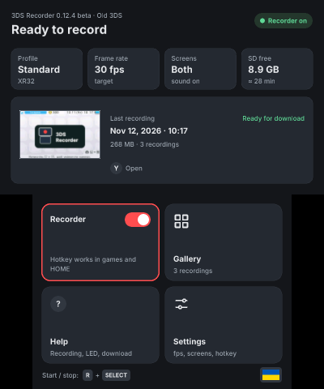
  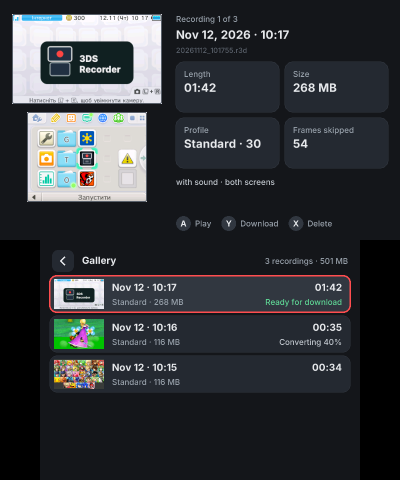
  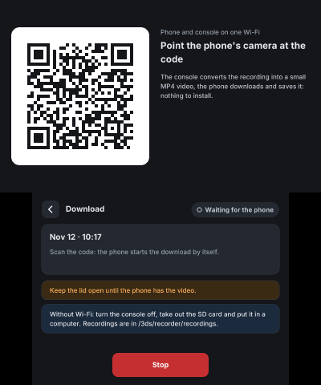
</p>

### Demo

<!-- the demo video: docs/demo.mp4 (kept locally), uploaded as a GitHub attachment -->

https://github.com/user-attachments/assets/122e7c76-d4c6-4f60-9426-aeed7d322776

*Recorded on an Old 3DS with 3DS Recorder itself: Mario Kart 7, both screens with sound. This is the MP4 the console
made, as it is (400 × 480), only cut shorter.*

More recordings, as they came out:

- [Old 3DS — HOME Menu and a Mario Kart 7 race](https://github.com/BolgarMaxym97/3ds-recorder/releases/download/v1.0.0/demo-old3ds-mk7.mp4) (2 min 19 s, 32 MB): the full
  video the clip above is cut from.
- [New 3DS XL — Resident Evil Revelations](https://github.com/BolgarMaxym97/3ds-recorder/releases/download/v1.0.0/demo-new3ds-re-revelations.mp4) (55 s, 11 MB): sent in
  by a tester; the recording was turned into MP4 on a computer with `tools/r3d2mp4.sh`.

---

<a id="english"></a>

## English

### What it is

3DS Recorder records the whole console: whatever is on the screens, in any game, the HOME Menu or a system app, with
the game sound. Press a button combination to start, press it again to stop — the video is saved to the SD card.

You do not need a PC or a capture card. The console turns each recording into a small MP4 video by itself, and you can
send it to your phone over Wi-Fi by scanning a QR code.

### What you need

- A Nintendo 3DS, 3DS XL, 2DS, New 3DS, New 3DS XL or New 2DS XL with **Luma3DS** custom firmware.
- **FBI** to install the `.cia` (or the Homebrew Launcher for the `.3dsx`).
- Free space on the SD card: up to **~320 MB per minute** in 3D games (both screens, 30 fps; menus and 2D games take much less). The MP4 made from it is about 25 MB a minute.
- To get videos on your phone: the phone and the console on the same Wi-Fi network (the console uses 2.4 GHz).

### Install

The newest version is always on the [Releases page](https://github.com/BolgarMaxym97/3ds-recorder/releases/latest): each release has `3ds-recorder.cia` and
`3ds-recorder.3dsx` under **Assets**. You need only one of them: the `.cia` puts an icon in the HOME Menu, the `.3dsx`
runs from the Homebrew Launcher.

1. Download `3ds-recorder.cia` (or `3ds-recorder.3dsx`) from the [latest release](https://github.com/BolgarMaxym97/3ds-recorder/releases/latest).
2. Copy it to the SD card. Install the `.cia` with FBI: SD → the file → **Install CIA**. The `.3dsx` needs no
   install: put it in the `/3ds/` folder.
3. Turn the console on while holding **SELECT** to open the Luma menu. Turn on
   **Enable loading external FIRMs and modules** and save with **START**.
4. Open **3DS Recorder**, choose your language and read the short guide. The recorder starts by itself: the
   notification LED glows blue for a moment.

**To update,** install the new `.cia` over the old one (or replace the `.3dsx`) and open the app: it updates the
recorder by itself. Settings and recordings stay.

### How to use

- **Start / stop a recording:** **R + SELECT**, anywhere — in a game, in the HOME Menu, in an app.
  You can close 3DS Recorder: the recorder keeps running in the background.
- **The LED tells you what is happening:**
  - blue for a moment — the recorder is ready;
  - red, breathing — recording;
  - green twice — the recording is saved;
  - red three times — something went wrong (usually a full SD card); open the app to see why.
- **After each power-on, open 3DS Recorder once** — that starts the recorder again.
- **Watch:** open the Gallery and press **A**.
- **Get the video on your phone:** in the Gallery press **Y** on a recording, scan the QR code with the phone's camera
  and tap **Save the video**. Nothing to install on the phone; iPhone and Android both work.
- **Or take it from the SD card:** recordings are in `/3ds/recorder/recordings/`. Next to each recording
  (`.r3d`) the console makes an `.mp4` that plays anywhere.
- **Settings:** frame rate (15 / 20 / 30 fps), both screens, the top one or the bottom one only, quality, sound on or off, the LED,
  the language and the button combination.
- **Quality:** with **Auto** a picture that changes all over (a 3D game in motion) is stored the way video is, colour at half
  the resolution, so both screens keep up to 30 frames a second on an Old 3DS; menus, 2D games and still pictures stay exact.
  **Lossless** keeps every frame exact; in 3D games the SD card then cannot take every frame and the video is less smooth.

<p align="center">
  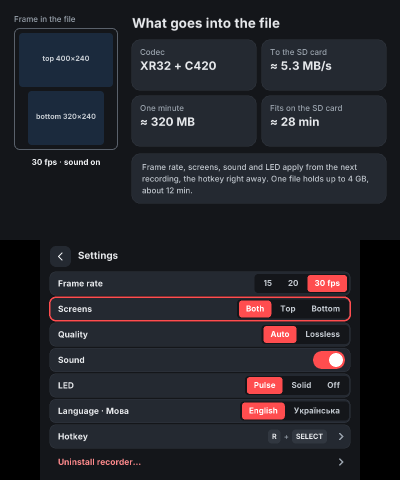
  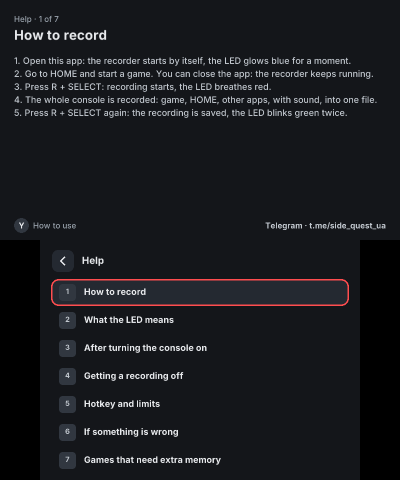
  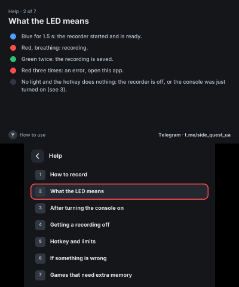
</p>

### Good to know

- **Leaving System Settings, starting a DS or GBA game, or turning the console off restarts the console.** The
  recording is saved and stops there; open 3DS Recorder again afterwards. The app tells you what happened.
- **Closing the lid** saves the recording; it goes on in a new file when you open the lid.
- **If the power is cut** (battery, crash), the recording is recovered the next time you open the app.
- **Long recordings** continue in a new file every 4 GB (a 1–2 second gap): the SD card's FAT32 limit.
- **Fast 3D scenes on a slow SD card** may be recorded at a lower frame rate for a moment: the card cannot keep up.
- **DS and GBA games can't be recorded:** they run in a separate mode of the console.
- **Games that need extra memory on an Old 3DS** (Smash Bros, Pokémon Sun / Moon and Ultra Sun / Ultra Moon,
  Super Mario Maker, Monster Hunter) restart the console when they start and when they close. If the recorder runs,
  it comes back inside the game by itself and the recording goes on in a new file: right before the restart it
  leaves Luma's plugin loader a one-time order to load a tiny launcher plugin (about 1 KB) into that game, which
  starts the recorder again and does nothing else. If the plugin loader is off, it is turned on for that one game
  and off again afterwards. The game gets 2 MB less memory, the recorder keeps its buffers in those 2 MB, and the
  video is less smooth there; recording only the top screen (Settings → Screens → Top) makes it smoother. When such a
  game closes, the recording is saved; open 3DS Recorder to record again.
  A New 3DS does not restart for these games.
- On a New 3DS, the few games that use the **800-pixel wide top screen** are recorded at 400 pixels: only the left half.

### Remove

Settings → **Uninstall recorder**. It removes the recorder, its settings and logs, and the app itself. Your recordings
stay unless you tick the box. Luma settings are not changed.

### Problems and feedback

3DS Recorder has been tested on an Old 3DS and a New 3DS XL with Luma3DS 13.5, but not on every console, game and SD
card. If something goes wrong, please open an [issue](../../issues/new), say what you did and what happened
(console model, game), and attach the log: on the phone page (the QR code) tap
**Log for the developer** at the bottom, or copy `/3ds/recorder/app.log` and `recorder.log` from the SD card.

### Building from source

The recorder is a Luma3DS sysmodule (`sysmod/`) plus the control app (`app/`), which carries the sysmodule and the launcher plugin (`plugin/`) inside.
A Docker image with devkitARM, libctru and 3gxtool builds all three:

```sh
docker build -t 3dsrec-dev tools/
tools/dkp.sh plugin make          # plugin/rec3ds-launch.3gx
tools/dkp.sh sysmod make          # sysmod/rec3ds.cxi
tools/dkp.sh app make cia         # app/3ds-recorder.cia and .3dsx
```

| Folder | What |
|---|---|
| `sysmod/` | the recorder: reads the screens and the sound, compresses them (XR32, lossless; C420 for pictures in motion) and writes `.r3d` |
| `app/` | the app: install, settings, gallery, player, the Wi-Fi server for the phone |
| `plugin/` | the launcher plugin for extended-memory games on an Old 3DS (starts the recorder again inside the game) |
| `prep/` | turns an `.r3d` into MP4 (H.264 + AAC) on the console |
| `web/` | the page the phone opens |
| `codec/` | the screen codecs and the `.r3d` format |
| `tools/` | build helpers, `r3dconv` / `r3d2mp4.sh` (`.r3d` → MP4 on a computer) |
| `tests/` | host tests and benchmarks |

### Thanks

[Luma3DS](https://github.com/LumaTeam/Luma3DS), [devkitPro / libctru / citro2d](https://devkitpro.org),
[minih264](https://github.com/lieff/minih264), [vo-aacenc](https://github.com/mstorsjo/vo-aacenc) (Apache 2.0),
[QR Code generator](https://www.nayuki.io/page/qr-code-generator-library) (MIT),
[mp4-muxer](https://github.com/Vanilagy/mp4-muxer) (MIT), [Inter](https://rsms.me/inter/) font (SIL OFL).
Their licenses are next to their code in `third_party/`, `web/vendor/` and `app/assets/fonts/`.

### License

[MIT](LICENSE). The third-party parts keep their own licenses (above).

---

<a id="ukrainian"></a>

## Українська

<p align="center">
  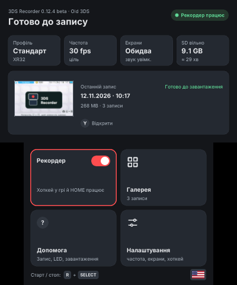
  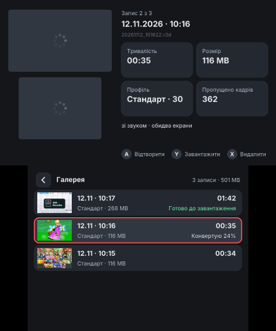
  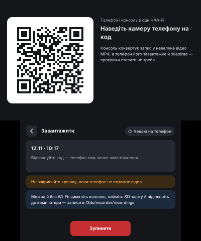
</p>

### Демо

https://github.com/user-attachments/assets/122e7c76-d4c6-4f60-9426-aeed7d322776

*Записано на Old 3DS самим 3DS Recorder: Mario Kart 7, обидва екрани зі звуком. Це MP4, який зробила сама консоль,
як є (400 × 480), лише обрізаний.*

Ще записи, як вони вийшли:

- [Old 3DS — меню HOME і заїзд у Mario Kart 7](https://github.com/BolgarMaxym97/3ds-recorder/releases/download/v1.0.0/demo-old3ds-mk7.mp4) (2 хв 19 с, 32 MB): повне
  відео, з якого вирізано кліп вище.
- [New 3DS XL — Resident Evil Revelations](https://github.com/BolgarMaxym97/3ds-recorder/releases/download/v1.0.0/demo-new3ds-re-revelations.mp4) (55 с, 11 MB): надіслав
  тестувальник; запис перетворено на MP4 на комп'ютері через `tools/r3d2mp4.sh`.

### Що це

3DS Recorder записує всю консоль: усе, що на екранах, у будь-якій грі, меню HOME чи системній програмі, разом зі
звуком гри. Натисніть комбінацію кнопок — запис почнеться, ще раз — відео збережеться на SD-картку.

Не потрібні ні комп'ютер, ні карта захоплення. Консоль сама перетворює кожен запис на невелике відео MP4, а забрати
його на телефон можна по Wi-Fi, відсканувавши QR-код.

### Що потрібно

- Nintendo 3DS, 3DS XL, 2DS, New 3DS, New 3DS XL або New 2DS XL з кастомною прошивкою **Luma3DS**.
- **FBI**, щоб встановити `.cia` (або Homebrew Launcher для `.3dsx`).
- Вільне місце на SD-картці: до **~320 MB на хвилину** у 3D-іграх (обидва екрани, 30 fps; меню і 2D-ігри займають набагато менше). MP4 з такого запису — близько 25 MB на хвилину.
- Щоб отримати відео на телефон: телефон і консоль в одній Wi-Fi мережі (консоль працює на 2.4 GHz).

### Встановлення

Найновіша версія завжди лежить на [сторінці Releases](https://github.com/BolgarMaxym97/3ds-recorder/releases/latest): у кожному релізі в розділі **Assets** є
`3ds-recorder.cia` і `3ds-recorder.3dsx`. Потрібен лише один із них: `.cia` додає іконку в меню HOME, `.3dsx`
запускається з Homebrew Launcher.

1. Завантажте `3ds-recorder.cia` (або `3ds-recorder.3dsx`) з [останнього релізу](https://github.com/BolgarMaxym97/3ds-recorder/releases/latest).
2. Скопіюйте файл на SD-картку. `.cia` встановіть через FBI: SD → файл → **Install CIA**. `.3dsx` встановлювати
   не треба: покладіть його в теку `/3ds/`.
3. Увімкніть консоль із затиснутою **SELECT** — відкриється меню Luma. Увімкніть
   **Enable loading external FIRMs and modules** і збережіть кнопкою **START**.
4. Відкрийте **3DS Recorder**, виберіть мову і прочитайте короткий гайд. Рекордер запуститься сам: індикатор LED
   на мить засвітиться синім.

**Щоб оновити,** встановіть новий `.cia` поверх старого (або замініть `.3dsx`) і відкрийте додаток: рекордер він
оновить сам. Налаштування і записи лишаються.

### Як користуватися

- **Почати / зупинити запис:** **R + SELECT** будь-де — у грі, в меню HOME, у програмі.
  3DS Recorder можна закрити: рекордер працює далі у фоні.
- **LED показує, що відбувається:**
  - синій на мить — рекордер готовий;
  - червоний «дихає» — іде запис;
  - зелений двічі — запис збережено;
  - червоний тричі — щось пішло не так (найчастіше заповнена SD-картка); відкрийте додаток, щоб дізнатися причину.
- **Після кожного ввімкнення консолі відкрийте 3DS Recorder один раз** — так рекордер запускається знову.
- **Переглянути:** відкрийте Галерею і натисніть **A**.
- **Отримати відео на телефон:** у Галереї натисніть **Y** на записі, відскануйте QR-код камерою телефона і натисніть
  **Зберегти відео**. На телефон нічого ставити не треба; працює і на iPhone, і на Android.
- **Або забрати з SD-картки:** записи лежать у `/3ds/recorder/recordings/`. Поруч із кожним записом (`.r3d`)
  консоль робить `.mp4`, яке відтворюється будь-де.
- **Налаштування:** частота кадрів (15 / 20 / 30 fps), обидва екрани, лише верхній чи лише нижній, якість, звук, LED, мова і
  комбінація кнопок.
- **Якість:** в режимі **Авто** картинка, яка змінюється вся (3D-гра в русі), зберігається як у відео — колір із половинною
  роздільністю, тому на Old 3DS обидва екрани тримають до 30 кадрів на секунду; меню, 2D-ігри й нерухомі картинки лишаються
  точними. **Без втрат** зберігає кожен кадр точно; у 3D-іграх SD-картка тоді не встигає за всіма кадрами і відео менш плавне.

<p align="center">
  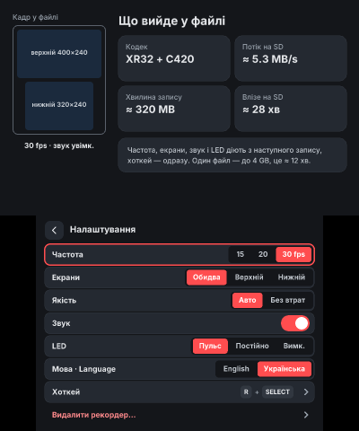
  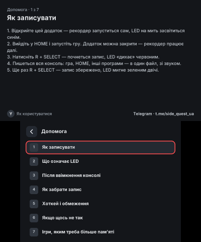
</p>

### Варто знати

- **Вихід з Налаштувань консолі, запуск DS- чи GBA-гри або вимкнення перезапускають консоль.** Запис на цьому
  зберігається і зупиняється; потім знову відкрийте 3DS Recorder. Додаток пояснить, що сталося.
- **Закрита кришка** зберігає запис, а після відкриття він продовжується новим файлом.
- **Якщо зникло живлення** (батарея, збій), запис відновиться, коли ви наступного разу відкриєте додаток.
- **Довгі записи** продовжуються в новому файлі кожні 4 GB (пауза 1–2 секунди): це обмеження FAT32 на SD-картці.
- **Швидкі 3D-сцени на повільній SD-картці** можуть на мить записатися з меншою частотою кадрів: картка не встигає.
- **DS- і GBA-ігри записати не можна:** вони працюють в окремому режимі консолі.
- **Ігри, яким на Old 3DS треба більше пам'яті** (Smash Bros, Pokémon Sun / Moon і Ultra Sun / Ultra Moon,
  Super Mario Maker, Monster Hunter), перезапускають консоль, коли стартують і коли закриваються. Якщо рекордер
  працює, він сам повертається в гру, а запис продовжується новим файлом: перед перезапуском він залишає
  завантажувачу плагінів Luma одноразову інструкцію завантажити в цю гру крихітний плагін-запускач (близько 1 КБ),
  який лише знову запускає рекордер. Якщо завантажувач плагінів вимкнено, він вмикається лише на цю гру і потім
  вимикається. Грі лишається на 2 МБ менше пам'яті, рекордер тримає свої буфери в цих 2 МБ, і відео там менш
  плавне; запис лише верхнього екрана (Налаштування → Екрани → Верхній) робить його плавнішим. Коли така гра
  закривається, запис зберігається; щоб писати далі, відкрийте 3DS Recorder. New 3DS для цих
  ігор не перезапускається.
- На New 3DS кілька ігор із **широким верхнім екраном 800 пікселів** записуються у 400 пікселях: лише ліва половина.

### Видалення

Налаштування → **Видалити рекордер**. Видаляє рекордер, його налаштування й журнали та сам додаток. Записи
лишаються, якщо не поставити позначку. Налаштування Luma не змінюються.

### Проблеми і відгуки

3DS Recorder перевірено на Old 3DS і New 3DS XL з Luma3DS 13.5, але не на кожній консолі, грі й SD-картці. Якщо щось
пішло не так, будь ласка, створіть [issue](../../issues/new), напишіть, що робили і що сталося
(модель консолі, гра), і додайте журнал: на сторінці в телефоні (через QR-код) унизу натисніть
**Журнал для розробника**, або скопіюйте з SD-картки `/3ds/recorder/app.log` і `recorder.log`.

### Збірка з кодів

Рекордер — це sysmodule для Luma3DS (`sysmod/`) і додаток керування (`app/`), який несе sysmodule в собі.
Обидва збираються в Docker-образі з devkitARM і libctru — команди й опис тек у розділі
[Building from source](#building-from-source).

### Подяки

[Luma3DS](https://github.com/LumaTeam/Luma3DS), [devkitPro / libctru / citro2d](https://devkitpro.org),
[minih264](https://github.com/lieff/minih264), [vo-aacenc](https://github.com/mstorsjo/vo-aacenc) (Apache 2.0),
[QR Code generator](https://www.nayuki.io/page/qr-code-generator-library) (MIT),
[mp4-muxer](https://github.com/Vanilagy/mp4-muxer) (MIT), шрифт [Inter](https://rsms.me/inter/) (SIL OFL).
Їхні ліцензії лежать поруч з їхнім кодом у `third_party/`, `web/vendor/` і `app/assets/fonts/`.

### Ліцензія

[MIT](LICENSE). Сторонні частини мають власні ліцензії (див. вище).

<p align="center">Зроблено в Україні 🇺🇦</p>
